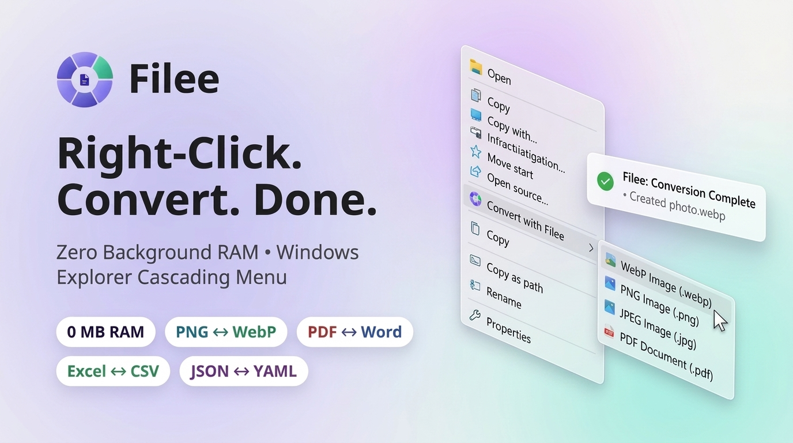

<p align="center">
  <a href="https://filee.sh"></a>
</p>

<p align="center">
  <b>A lightweight, zero-RAM file converter for everyday student, office, and developer workflows.</b><br>
  Convert files on-demand via the Windows Explorer right-click context menu or the headless CLI.
</p>

<p align="center">
  <a href="docs/SETUP.md"><b>Setup Guide</b></a> ·
  <a href="#supported-formats">Supported Formats</a> ·
  <a href="#command-line">Command Line</a> ·
  <a href="#development">Development</a> ·
  <a href="docs/ARCHITECTURE.md">Architecture</a>
</p>

<p align="center">
  
  
  
  <a href="LICENSE"></a>
</p>

---

<table>
  <tr>
    <td width="33%" valign="top">
      <b>0 MB Background RAM</b><br>
      No background services, tray processes, or memory-resident window trees. Filee spawns only when you convert, delivers results, and exits cleanly.
    </td>
    <td width="33%" valign="top">
      <b>Explorer Context Menu</b><br>
      Right-click any supported file in File Explorer to access context-sensitive cascading submenus. Visual loading state and native Windows Action Center notifications.
    </td>
    <td width="33%" valign="top">
      <b>100% Offline & Private</b><br>
      All conversions run locally on your machine with high-performance native engines. No files are ever uploaded or sent across the network.
    </td>
  </tr>
</table>

---

## Quick Start

### 1-Click Installation (Windows 10 & 11)
1. Download **[`Filee-Setup.exe`](https://github.com/Deepesh70/Filee-Lean/releases/latest)** from the latest release.
2. Run the installer (zero admin privileges required).
3. Right-click any file in Windows Explorer to convert, or run `filee` in any terminal!

Prefer portable? Download **`Filee-win-x64.zip`**, extract anywhere, and double-click `install.cmd`.

---

## Supported Formats (9 Core Engines)

Filee focuses on the core document, image, spreadsheet, and data formats used every day, powered by high-speed, lightweight libraries:

| Category | Input Formats | Target Formats | Engine / Library |
|---|---|---|---|
| **Images** | PNG, JPG, JPEG, WEBP, BMP, GIF, ICO | JPEG, PNG, WEBP, PDF | `SkiaSharp` (high-speed cubic filtering) |
| **Vectors** | SVG, SVGZ | PDF (vector), PNG, JPG | `Svg.Skia`, `SkiaSharp` |
| **PDF** | PDF | PNG Images, Word (`.docx`), Markdown (`.md`), Plain Text (`.txt`) | `PDFtoImage` (PDFium), `PdfPig`, internal XML generator |
| **Documents** | Markdown (`.md`), Plain Text (`.txt`) | PDF, Word (`.docx`), HTML | `Markdig`, internal XML builder |
| **Spreadsheets** | Excel (`.xlsx`, `.xls`), ODS, CSV, TSV | CSV, Excel (`.xlsx`) | `ExcelDataReader`, internal CSV generator |
| **Structured Data** | JSON, YAML, TOML, XML | JSON, YAML, TOML, CSV | `System.Text.Json`, `YamlDotNet`, `Tomlyn`, `System.Xml` |

---

## Windows Explorer Context Menu

On Windows 10 and 11, right-click any supported file in File Explorer to open the **Convert with Filee ▸** menu.

- **Dynamic Cascading Submenus:** Only options valid for the selected file type appear.
- **Windowless Background Conversion:** `filee-run.exe` displays the Windows loading spinner on the cursor without opening command prompt windows.
- **Action Center Feedback:** Native Windows toast notification alerts you when conversion finishes.
- **Bulk Selection Support:** Converts multiple selected files or processes large batches via `@list` response files.

See the [Setup & Installation Guide](docs/SETUP.md) for 1-step registration.

---

## Command Line

The `filee` CLI (`filee-cli.exe`) runs completely headlessly:

```bash
# Convert an image to WebP with native toast notification
filee convert photo.png --to webp --notify

# Convert Markdown notes to a Word document
filee convert notes.md --to docx --notify

# Extract an Excel spreadsheet sheet to CSV
filee convert data.xlsx --to csv --notify

# Extract pages from a PDF as PNG images
filee convert document.pdf --to png --notify

# Convert JSON to YAML
filee convert config.json --to yaml --notify

# Watch a folder and automatically convert incoming files
filee watch D:\Incoming --to pdf --move-originals
```

---

## Architecture & Design

Filee transitioned from a heavy multi-engine Avalonia desktop suite into an ultra-lean architecture:

- **From Magick.NET to SkiaSharp:** Replaced the ~40 MB Magick.NET C++ wrapper with lightweight SkiaSharp, reducing footprint and improving throughput.
- **Engine Pruning:** Removed 27 niche engines (CAD, 3D models, Hancom HWP, archives, subtitles, fonts, geospatial data, and heavy office runtimes).
- **From UI to Shell Integration:** Replaced the ~100 MB resident Avalonia UI with on-demand Windows shell integration (`FileeExplorerMenu.dll` and `filee-run.exe`) compiled with zero C-runtime overhead via Zig.

Read the full details in [docs/ARCHITECTURE.md](docs/ARCHITECTURE.md) and [docs/ENGINES.md](docs/ENGINES.md).

---

## Development

Build with the .NET 10 SDK on Windows:

```powershell
# 1. Clone repository
git clone https://github.com/KnifeLemon/Filee.git
cd Filee

# 2. Build CLI
dotnet build src/Filee.Cli/Filee.Cli.csproj

# 3. Build Explorer Context Menu Shell Extension
pwsh build/build-explorer-menu.ps1

# 4. Run automated test suites
dotnet test tests/Filee.Core.Tests/Filee.Core.Tests.csproj
dotnet test tests/Filee.Engines.Tests/Filee.Engines.Tests.csproj
```

See [docs/SETUP.md](docs/SETUP.md) for full developer and user walkthroughs.

---

## Acknowledgements & License

- **Acknowledgements:** Originally based on [Filee by KnifeLemon](https://github.com/KnifeLemon/Filee), re-architected into an ultra-lean, zero-RAM pipeline with native Windows Explorer cascading shell integration and SkiaSharp.
- **License:** Licensed under the [MIT License](LICENSE).
